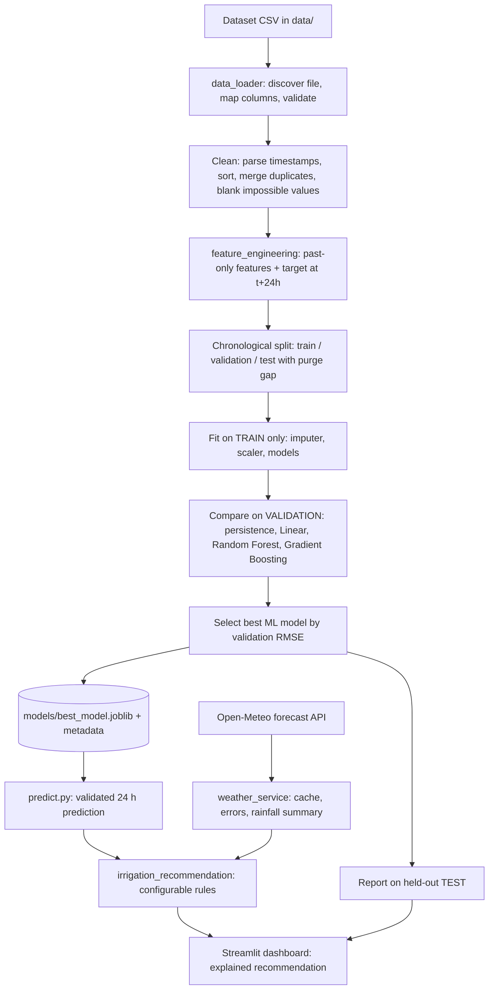

# Methodology and architecture

## 1. Problem definition

**Task:** supervised regression. Given the state of the field at time *t* (current and recent soil moisture, recent
weather, recent irrigation, time of day/year), predict soil moisture at **t + 24 h**.

**Forecast horizon:** 24 hours (`config.FORECAST_HORIZON_HOURS`). The target is looked up **by timestamp**
(the observation closest to t + 24 h, within half a sampling interval). If no such observation exists the sample is
dropped rather than paired with a wrong value.

## 2. Workflow

## 3. Architecture and module responsibilities

| Module | Responsibility |
|--------|----------------|
| `src/config.py` | Paths, constants, column-role patterns, API URLs, defaults, local overrides. |
| `src/data_loader.py` | Find the dataset, map columns to roles, clean, infer the sampling interval; CLI inspection. |
| `src/feature_engineering.py` | Past-only features, timestamp-based target, chronological split with purge gap. |
| `src/preprocessing.py` | Imputation/scaling pipelines (fitted on train only), input validation for predictions. |
| `src/train_model.py` | Reproducible training, validation-based model selection, artifact saving. |
| `src/evaluate_model.py` | MAE/RMSE/R², comparison table, plots. |
| `src/predict.py` | Load model, validate inputs, predict, classify change; `predict_from_history` for IoT integration. |
| `src/weather_service.py` | Open-Meteo forecast/historical client with caching, retries, safe errors, rainfall summary. |
| `src/irrigation_recommendation.py` | Pure, testable decision rules - no ML, no network. |
| `app.py` | Streamlit UI that calls the modules above. |

The recommendation engine knows nothing about the model, and the model knows nothing about the weather API.
They meet only in the dashboard (and in any future IoT application) through plain numbers.

## 4. Data handling

- Files are discovered recursively under `data/`; the best candidate has a timestamp and soil-moisture column and a
  name that suggests a regular time series rather than raw exports or event tables.
- **Columns are mapped to roles by name heuristics and printed for you to verify.** The dataset schema was not available
  when the code was written, so nothing is hard-coded; overrides go in `config.local.json`.
- Columns that look like engineered features or targets (`target`, `lag`, `roll`, `ahead`, ...) are never selected as raw inputs.
- Cleaning: timestamps parsed (UTC-normalised), invalid timestamps dropped, rows sorted, duplicate timestamps averaged,
  non-numeric values -> NaN, impossible values (negative moisture/precipitation/irrigation, humidity outside 0-100) -> NaN.
- Sampling interval = median spacing of timestamps. It is verified and reported, then used for lag lookups and tolerances.

### Dataset subset (complete this after inspecting the real files)

| Item | Your entry |
|------|-----------|
| File used | _e.g. `data/.../sector_X_timeseries.csv`_ |
| Sector / crop | _fill in_ |
| Soil-moisture column, unit, depth | _fill in from DATA_DICTIONARY.md_ |
| Precipitation unit (per-interval / rate / cumulative) | _fill in; `precip_sum_*` assume a per-interval amount_ |
| Why this subset | _fill in_ |

## 5. Features (all use observations at or before time *t*)

| Group | Features |
|-------|----------|
| Soil moisture | current value; lags 1, 3, 6, 12, 24 h; change over those lags; rolling mean over 6 h and 24 h |
| Weather (past) | temperature and humidity: current + 24 h rolling mean; precipitation: 6 h and 24 h sums; evapotranspiration 24 h sum (if the column exists) |
| Irrigation (past) | applied water summed over the last 24 h (if the column exists) |
| Time | hour of day and day of year, encoded as sine/cosine |

Optional groups are created only when the dataset has the corresponding column. Rows need the current value and the 24 h
lag; other missing values are imputed with training medians.

## 6. Leakage prevention

1. Features use only past/current data (a test verifies that changing data after *t* does not change the features at *t*).
2. The target is the only quantity that looks forward, and it never enters the feature set.
3. Dataset-supplied target/engineered columns are not used as inputs.
4. Chronological split (default 70/15/15), no shuffling.
5. **Purge gap:** the last 24 h of the training (and validation) period are removed so that no training target is
   realised inside the following period.
6. Imputer, scaler and models are fitted on the training split only (inside one scikit-learn `Pipeline`).
7. Model selection uses the validation split; the test split is evaluated once, after selection.
8. Actual future weather is **not** used as a stand-in for a forecast.

## 7. Models and evaluation

- **Persistence baseline:** prediction = current soil moisture.
- **Linear Regression** (standardised inputs), **Random Forest Regressor**, **Gradient Boosting Regressor**
  (`random_state=42`).
- Metrics: MAE, RMSE (same unit as soil moisture), R². The best ML model has the lowest **validation** RMSE; if it does not
  beat persistence, the run says so.
- Importance: permutation importance on the validation set (model-agnostic).
- Reproducibility: fixed seed; results repeat up to floating-point rounding.

## 8. Weather and recommendation

- The model is trained on **past weather observations from the dataset**. It is **not** trained on forecasts.
- Open-Meteo **forecast** data (future) is fetched at prediction time and summarised as expected rainfall in the next *N*
  hours (default 24). It is used **only** by the recommendation rules.
- Open-Meteo **historical** data is exposed separately and labelled as past reanalysis.
- Rules (`irrigation_recommendation.py`): no threshold or no moisture value -> insufficient information; moisture not below the
  dry threshold now or in 24 h -> monitor; dry and meaningful rain (amount and probability thresholds) -> consider delaying; dry
  and critically low -> irrigation may be needed regardless of rain; dry and little/unknown rain -> irrigation may be needed
  (with a warning when the forecast is unknown, because rain is never assumed).
- Thresholds are inputs, not facts. No water quantities are produced and no equipment is controlled.

## 9. Limitations

See the README. In short: one site/season, past-weather training, uncalibrated thresholds, forecast uncertainty, and a
heuristic column mapping that must be confirmed against the data dictionary.

## 10. Path to IoT integration

`predict.predict_from_history(bundle, dataframe)` accepts a table of recent readings (timestamp, soil moisture, optional weather)
with the same column names as the training data and returns a prediction. A separate IoT project can export a CSV or call this
function. At least 24 h of history is required. Automatic actuation is intentionally not implemented.
